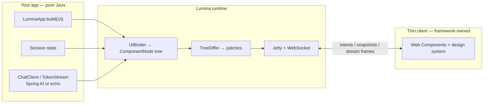

# Lumina

[](LICENSE)
[](pom.xml)
[](https://wosslabs-lumina.readthedocs.io/)

**Lumina** is an open-source Java framework for interactive, server-driven web apps.
Inspired by Streamlit and built for modern Java and AI workloads, it owns rendering,
session state, and real-time UI updates so application code needs **no HTML, CSS, or JavaScript**.

**Maintainer:** [Tenzing Wangdi](https://www.linkedin.com/in/tenzing/) · GitHub [`wosslabs`](https://github.com/wosslabs)

**Status:** `1.0.0` — first community release (Apache-2.0), **GitHub soft launch**.
Target Maven coordinates: `io.github.wosslabs` (not on Maven Central yet). Java packages remain `io.lumina.*`.
Install by building from source or from tag `v1.0.0` until Central is live — see [docs/RELEASING.md](docs/RELEASING.md).

## How it works

You declare UI and AI surfaces in Java. Lumina rebuilds a component tree on each
interaction, diffs it, and patches a thin browser client over WebSocket — so you
never write front-end code.



| You write | Lumina owns |
|-----------|-------------|
| `ui.title`, `ui.chatShell`, `ui.ai(stream)` | HTML, CSS, JS client |
| Session state and routing | Diff/patch protocol |
| Optional Spring Boot / Spring AI wiring | Embedded Jetty, sessions, Origin checks |

## Developer guide

**Start here:** [docs/DEVELOPER_GUIDE.md](docs/DEVELOPER_GUIDE.md) — extensive onboarding for
standalone Java, Jakarta EE / other frameworks, Spring Boot, and Spring AI.

AI cockpits: [docs/AI_GUIDE.md](docs/AI_GUIDE.md) (RAG, agents, MCP UI).

Hosted docs: [wosslabs-lumina.readthedocs.io](https://wosslabs-lumina.readthedocs.io/) (builds from this repo via MkDocs).

## Requirements

- **Java 25+** and **Maven 3.9+**
- Platform stack: Spring Boot **4.1.0**, Spring AI **2.0.0**, Jetty **12.1.11** (EE11)

## Maven coordinates

Target `groupId` after Central publish: `io.github.wosslabs`. **Artifacts are not on Maven Central yet** — clone and build from tag `v1.0.0` (or `main`):

```bash
git clone https://github.com/wosslabs/lumina.git
cd lumina
git checkout v1.0.0
mvn -q -pl lumina-web,lumina-spring-boot-starter -am install
```

When Central is live, these coordinates will resolve without a local install:

```xml
<!-- Standalone / any framework -->
<dependency>
  <groupId>io.github.wosslabs</groupId>
  <artifactId>lumina-web</artifactId>
  <version>1.0.0</version>
</dependency>

<!-- Spring Boot -->
<dependency>
  <groupId>io.github.wosslabs</groupId>
  <artifactId>lumina-spring-boot-starter</artifactId>
  <version>1.0.0</version>
</dependency>
```

If the app also has `spring-boot-starter-web` / `webmvc`, set `lumina.port=8090` and open
**http://127.0.0.1:8090/** — not Tomcat’s `:8080` (that page often shows **Disconnected**).
See [docs/DEVELOPER_GUIDE.md](docs/DEVELOPER_GUIDE.md#7-path-b--spring-boot).

Optional: `lumina-spring-ai`, `lumina-cli`.

## Showcase quickstart

```bash
git clone https://github.com/wosslabs/lumina.git
cd lumina
mvn -q -pl lumina-examples -am install
mvn -q -pl lumina-examples exec:java -Dexec.mainClass=io.lumina.examples.showcase.ShowcaseMain
```

Open [http://127.0.0.1:8080](http://127.0.0.1:8080) for the enterprise shell, routing,
widgets, and AI demos (`/`, `/about`, `/widgets`, `/ai`).

The server binds to `127.0.0.1` by default. Use
`LuminaServerConfig.builder().host("0.0.0.0")...` to expose it on the network.

**Other paths** (see [lumina-examples/README.md](lumina-examples/README.md)):

```bash
# Path B — Spring Boot (UI on :8090)
env -u SPRING_CONFIG_IMPORT mvn -q -pl lumina-examples-spring -am spring-boot:run

# Path C — Boot + Spring AI (echo offline; set OPENAI_API_KEY for live)
env -u SPRING_CONFIG_IMPORT mvn -q -pl lumina-examples-spring-ai -am spring-boot:run
```

## Hello AI

Minimal stateful chat with the built-in offline echo client:

```bash
mvn -q -pl lumina-examples -am install
mvn -q -pl lumina-examples exec:java
```

Default entry point: `io.lumina.examples.helloai.HelloAiMain`.

## Streaming chat

```bash
mvn -q -pl lumina-examples -am install
mvn -q -pl lumina-examples exec:java -Dexec.mainClass=io.lumina.examples.streaming.StreamingChatMain
```

See [`lumina-examples/README.md`](lumina-examples/README.md#streaming-chat).

## Docs

- [**Developer guide** (start here)](docs/DEVELOPER_GUIDE.md)
- [**AI guide** — RAG / Agents / MCP](docs/AI_GUIDE.md)
- [Product overview](docs/PRODUCT.md)
- [Author cheat sheet](docs/GUIDE.md)
- [Vision and roadmap](docs/VISION.md)
- [Architecture](docs/ARCHITECTURE.md)
- [Extensions](docs/EXTENSIONS.md)
- [Migration](docs/MIGRATION.md)
- [Releasing / Maven Central](docs/RELEASING.md)
- [Contributing](CONTRIBUTING.md)
- [Security](SECURITY.md)
- [Changelog](CHANGELOG.md)

Hosted docs: [wosslabs-lumina.readthedocs.io](https://wosslabs-lumina.readthedocs.io/)

## Modules

| Module | Role |
|--------|------|
| `lumina-core` | App, UI, state, model, AI, and transport contracts |
| `lumina-session` | Isolated session and widget state |
| `lumina-components` | Built-in component property definitions |
| `lumina-runtime` | Binding, execution, tree diffing |
| `lumina-web` | Jetty server, WebSocket, wire protocol, thin client |
| `lumina-devtools` | File-watch reload |
| `lumina-spring-boot-starter` | Optional Spring Boot auto-configuration |
| `lumina-spring-ai` | Spring AI `ChatClient` → `TokenStream` bridge |
| `lumina-cli` | CLI launcher for `LuminaApp` |
| `lumina-examples` | Showcase, Hello AI, streaming chat, agent demo |

## 1.0 limitations

- Multi-node session clustering is not shipped.
- SSE as an alternate transport is not shipped.
- Cloud LLM coverage depends on Spring AI configuration; echo works offline.

## Author

Built and maintained by [Tenzing Wangdi](https://www.linkedin.com/in/tenzing/) ([`wosslabs`](https://github.com/wosslabs)).

## License

Copyright © Lumina contributors. Licensed under the [Apache License 2.0](LICENSE).
